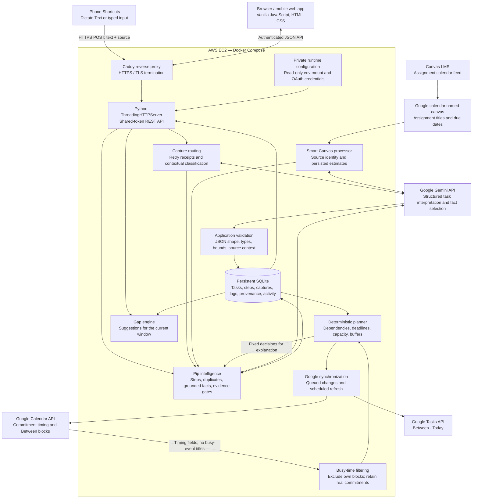

<p align="center">
  
</p>

# Between

**Between — Life happens between your plans.**

**SunHacks 2026 — Solo Developer Project**

Between turns a student's scattered thoughts, assignment deadlines, and available calendar gaps into manageable next actions. Capture a thought, find a realistic place for the work, and start with one small step.

[](#technology-stack)
[](#technology-stack)
[](#persistence-and-migrations)
[](#ai-intelligence-and-decision-making)
[](#cloud-deployment)

**[Watch the official demo](https://www.youtube.com/watch?v=zYgGRX92xEA)** · **[Open the live application](https://pipbetween.duckdns.org)**

[](https://www.youtube.com/watch?v=zYgGRX92xEA)

Pip's demo narration was created with **ElevenLabs**. That credit applies to the video; the application receives dictated text through iPhone Shortcuts and does not use ElevenLabs at runtime.

Submitted to SunHacks 2026. The portfolio documentation and repository publication were finalized after submission. The live deployment is a single-user application: viewing private tasks requires an authorized device link.

## Inspiration and problem

You have 25 minutes before class, a reading due tonight, a quiz on Friday, and a reminder you told yourself you would remember.

The time is there, but figuring out what to do with it takes time too. A calendar shows where you need to be. A to-do list shows what you owe. You still have to connect the two, estimate the work, and decide where to start.

Between grew from that gap between remembering and beginning. It is designed for students navigating procrastination, executive-function demands, and task initiation. The goal is to reduce the decisions required to start, without guilt or a constant stream of notifications. This is a product design goal, not a claim of clinical effectiveness.

> “Read chapter four for twenty minutes by tomorrow, start my reflection paper before Friday, and email my professor.”

A thought like this can arrive as typed text or iPhone dictation. Between separates the obligations, records what is known, asks for a missing detail when needed, and works around the calendar rather than requiring the student to build a schedule manually.

## Meet Pip

Pip is Between's original companion character: a small, cozy presence beside the plan. Pip asks useful follow-up questions, explains recorded scheduling decisions, and offers a next action when the whole task feels too large.

The interface keeps work in three groups: **Urgent & important**, **Urgent**, and **Important**. Larger tasks reveal one next step, while the full sequence remains available. **Not today**, time logging, and a quiet **Someday** area acknowledge that plans change.

## Core capabilities

| Capability | Implemented behavior |
| --- | --- |
| Voice-first capture | An iPhone Shortcut uses Dictate Text or typed input, then posts JSON to the authenticated capture API. Between receives text, not raw audio. |
| Cross-device access | Phone and browser use the same hosted SQLite-backed API. The dashboard refreshes on load, after actions, and periodically; updates are not pushed through a realtime channel. |
| Structured task extraction | Gemini interprets brain dumps into actionable titles, estimates, deadlines, categories, and occasional clarification questions. Local rules handle model failure. |
| Approachable task steps | Eligible new tasks estimated at 90 minutes or more receive persistent, ordered steps. Only the next step is actionable; parents summarize progress rather than consume scheduling time. |
| Conservative duplicate detection | Normalized title tokens, selected synonyms, deadline checks, and source identity support unambiguous reuse. Separate Canvas IDs and ambiguous candidates remain separate. |
| Quiet filing | Tasks without deadline or urgency signals can be saved to Someday without follow-up questions or scheduled sessions. They can be explicitly brought back into the plan. |
| Ask Pip | Read-only answers about next actions, deadlines, progress, and scheduling use recorded facts. Gemini selects supported fact IDs rather than producing unrestricted advice. |
| Scheduling explanations | Gemini selects among valid explanations of fixed scheduling decisions, including free time, deadlines, and completed steps; rule text remains available. |
| Behavioral observations | Recorded work and skips can support category-specific observations after evidence thresholds are met. Users accept or dismiss them; acceptance does not change scheduling preferences automatically. |
| Smart Canvas processing | Assignments from a Google calendar named `canvas` receive action titles, type-based estimates, and stored provenance. Repeat imports preserve edits and progress. A legacy direct Canvas API adapter is also present. |
| Calendar and Tasks outputs | The plan becomes **“Between:” blocks in Google Calendar** and a **“Between · Today” list in Google Tasks**. Progress changes queue a refresh. |
| Mobile web interface | Responsive HTML/CSS, original Pip SVG art, a web app manifest, and service-worker source support the mobile web design. Offline behavior is not verified. |

## System architecture



The main boundaries are explicit: Gemini interprets incomplete language and selects helpful wording; Python owns identity, state changes, evidence thresholds, and scheduling constraints. SQLite persists the result, so planning does not depend on a model remembering previous conversations.

## End-to-end data flow

1. **Capture.** A trusted browser or Shortcut sends `{text, source}` to `/api/capture`. Optional idempotency keys and a bounded retry receipt for keyless captures reduce duplicates from retries.
2. **Interpret and validate.** Gemini proposes tasks and clarification questions. The server parses fields, normalizes estimates and dates, and falls back to local routing when interpretation is unavailable.
3. **Reconcile and persist.** Conservative matching can attach a mention to an existing task. New work is classified, quietly filed when appropriate, and saved with its capture/source relationships.
4. **Decompose.** An eligible large task receives validated ordered steps or a deterministic fallback that preserves its estimated workload. Existing logged progress is protected.
5. **Find capacity.** Calendar event timing is filtered into free stretches. Between's own exported blocks are excluded from busy time so they do not block the next plan.
6. **Schedule and explain.** Python schedules the remaining leaf work within constraints. Pip can explain those fixed choices using supported facts.
7. **Publish and adapt.** Google outputs reflect planned sessions. Completion, logs, estimates, and skips invalidate cached planning state and queue synchronization; the browser reloads the shared state.

Canvas import enters at step 3 through a shared persistence path. Source IDs and processing metadata make repeat imports stable without repeatedly asking Gemini to reinterpret the same assignment.

## AI intelligence and decision-making

The AI pipeline has distinct contracts rather than one general-purpose prompt with authority over the application.

| Stage | Gemini's role | Application-owned boundary |
| --- | --- | --- |
| Capture | Extract tasks, estimates, due dates, categories, and up to three questions | Parse and normalize fields; reuse known tasks conservatively; persist state in SQLite |
| Canvas | Clean an assignment title and suggest a type and estimate | Schema and type bounds, retained academic context, stable source IDs, persisted fallback/provenance |
| Decomposition | Suggest ordered, actionable work phases | Valid step count, action wording, 10–60 minute estimates, exact total workload, no invented assignment details |
| Ask Pip | Select one or two relevant facts and an approved opening | Read-only context, known fact IDs, no tool execution, disclosure when calendar availability cannot be verified |
| Explanations | Choose a supported reason for a fixed session | Scheduling decisions remain unchanged; unsupported facts and arbitrary prose are rejected |
| Behavioral insight wording | Select wording for an already supported observation | Deterministic evidence gates and accept/dismiss state; no inferred diagnosis or automatic preference changes |

Pip and Canvas calls use JSON response schemas; capture requests use JSON responses with application parsing. Pip and Canvas prompts label source text as untrusted data and limit the model to information actually available. Validation rejects unsupported fields, invented academic context, invalid numbers, or unknown references where the relevant contract requires it. Timeouts, AI budgets, bounded caches, and deterministic fallbacks limit the effect of failed or malformed responses.

Smart Canvas distinguishes eleven assignment types. Defaults reflect the type rather than assigning every item the same duration: for example, a quiz is 25 minutes, reading 40, a reflection 120, and exam preparation 180. Explicitly labeled durations can override defaults within validated bounds. These are estimates from titles, not claims about unseen assignment requirements. See [Smart Canvas design](docs/SMART-CANVAS.md).

Behavioral personalization is evidence-gated analysis, not a trained model. Duration observations require at least eight completed tasks or steps in a category with logged time, at least four dates spanning fourteen days, and a consistent overrun pattern. Skip-timing observations also require sufficient skip and work records. Missing logs are not treated as failure. Accepting an observation stores the decision without silently changing the schedule.

## Scheduling algorithms and constraints

The active two-week planner uses deterministic heuristics in [`task_rules.py`](task_rules.py). It orders work by deadline, skip history, and priority, traverses dependencies, then allocates sessions into free calendar slots. It is a greedy scheduler, not an optimal constraint solver.

| Constraint | Current behavior |
| --- | --- |
| Planning horizon | Fourteen daily windows, from 07:00 to 22:00 in the configured time zone |
| Session size | 10–60 minutes in the multi-day planner; remaining work under ten minutes reserves the minimum block |
| Daily workload | At most 240 minutes of planned task work per day |
| Spreading | At most one session per leaf task per day; a parent can have multiple ordered steps in a day |
| Transitions | Five-minute buffers between allocated work sessions |
| Dependencies | Later steps wait until predecessor work has been allocated; cycles or missing dependencies remain unplaced |
| Remaining work | Logged minutes reduce estimated work; completed steps do not consume future capacity |
| Skips | Not today removes the task from today's plan; dependents wait for the skipped work |
| Capacity shortfall | Work that cannot fit is reported as unplaced rather than assumed complete |
| Deadline handling | Work is placed before a recorded deadline when capacity permits; overdue work remains eligible today |

The separate [`gap_engine.py`](gap_engine.py) answers “what fits this window?” It uses a 15-minute minimum window, a 90-minute partial-session cap, remaining estimates, and a simpler due-text urgency rule. Short windows favor finishing smaller work; larger windows favor larger work. It receives only eligible next actions and excludes work skipped today. These window suggestions are distinct from the two-week calendar allocation.

## Persistence and migrations

SQLite stores the system's state in related tables:

- **Work:** `tasks` holds root tasks and self-referencing child steps; `time_logs` records progress; `pending_questions` stores clarification state.
- **Provenance:** `inbox_items`, `notes`, `external_items`, and `task_mentions` preserve capture and assignment relationships. Canvas processing metadata records the original source and processing decision.
- **Reliability:** `capture_receipts` stores retry responses; unique source identifiers and step-order indexes constrain duplicate insertion.
- **Personalization:** `activity_events` records explicit work/skip observations; `insight_decisions` persists acceptance and dismissal.

Initialization creates missing tables and adds missing columns/indexes. Migration and restart fixtures verify preservation of IDs, estimates, completion, and logs. Old tasks are not bulk rewritten or re-estimated. Additive SQL compatibility does not make old application code safe to run against new parent/child semantics; rollback requires a data-aware plan.

## Technology stack

| Layer | Technologies | Responsibility |
| --- | --- | --- |
| Interface | JavaScript, HTML5, CSS3, SVG | Responsive dashboard, task interactions, Pip, safe rendering |
| Mobile web | Web app manifest, service-worker source | Standalone display metadata and cache scaffolding; offline support remains unverified |
| Backend | Python standard library, `ThreadingHTTPServer`, JSON/HTTP APIs | Routing, authentication, orchestration, validation, background sync |
| Intelligence | Google Gemini API | Language interpretation, structured outputs, constrained fact selection |
| Storage | SQLite, SQL, foreign keys, indexes | Durable relational state and additive schema migrations |
| Integrations | Google Calendar API, Google Tasks API, Google OAuth, Canvas calendar feed | Commitments, deadlines, scheduled sessions, task exports |
| Phone capture | iOS Shortcuts and dictation | Voice-to-text capture and authenticated JSON requests |
| Infrastructure | AWS EC2, Docker, Docker Compose, Caddy, DuckDNS | Container hosting, reverse proxy, HTTPS/TLS, DNS |
| Delivery | Shell scripts, SSH, rsync, Git, GitHub | Existing-host deployment automation and version control |
| Validation | Python `unittest`, Node.js VM runtime harness | Logic, regression, migration, integration-fixture, and frontend runtime checks |

No third-party Python packages or frontend build toolchain are required by the application. Node.js is used for the synthetic frontend checks, not the production server.

## Engineering decisions and trade-offs

- **AI interpretation with deterministic execution.** Language models help with ambiguity; Python retains control over stored state, deadlines, capacity, dependencies, and available time. This makes behavior testable without a live model.
- **Conservative reconciliation.** Matching uses explicit normalization and identity checks rather than embeddings or broad semantic similarity. It accepts some missed duplicates to reduce accidental merging of distinct assignments.
- **Title-based Canvas estimates.** The calendar feed exposes titles and due dates, so the importer preserves context and uses bounded priors rather than inventing assignment contents.
- **Persistent provenance and fallbacks.** A recurring import reuses its stored processing decision, including a rules fallback. New model access does not silently rewrite old work or user edits.
- **Small deployment footprint.** Standard-library Python, vanilla JavaScript, and SQLite reduce build and dependency overhead for a solo hackathon. The trade-off is a single-user, single-process design with coarse in-process locks rather than a distributed service.
- **Asynchronous integration updates.** Queued refreshes and scheduled synchronization keep request handling manageable. Google Calendar and Tasks are separate services; exports are best effort and cannot form one atomic transaction.
- **Privacy boundaries.** Gemini receives relevant task data and calendar timing, while unrelated busy-event titles are not requested or included in its context. The hosted app protects private API data with a shared device token.

## Testing and validation

The recorded release validation, reconfirmed during repository publication, passed:

| Check | Result | Scope |
| --- | --- | --- |
| Backend suite | **261 passed; zero failures/errors** | Python unit and regression tests; external HTTP and socket connections blocked |
| Frontend runtime harness | **8 passed; zero failures** | Actual dashboard JavaScript executed against a synthetic DOM |
| Python syntax | Passed | 31 Python files |
| JavaScript syntax | Passed | Dashboard, service worker, and frontend runtime harness |
| Shell syntax | Passed | Shell helpers and documented release commands |
| Migration and persistence | Passed within backend suite | Legacy schema initialization, repeated startup, stable IDs, edits, logs, and processing state |
| Whitespace validation | Passed | `git diff --check` |

Fixtures cover structured-output rejection, model timeouts/fallbacks, ordered steps, duplicate handling, capture retries, quiet filing, factual answers, evidence thresholds, deadline propagation, skip behavior, and mocked Google exports. Frontend checks include full dashboard loading, step rendering, escaping, Ask Pip success/failure, and retry-key reuse.

Run the suites from an isolated checkout:

```bash
/usr/bin/python3 -m unittest discover -s tests -p 'test_*.py'
node tests/frontend_runtime.cjs
```

Tests use temporary data, mock external integrations, and disable automatic Google synchronization. The application is already working in the hosted deployment, as confirmed by the developer. Automated fixtures do not establish comprehensive browser coverage, verified offline behavior, trained-model quality, or performance benchmarks. The publication session did not deploy, restart, or change production data. See [release validation](docs/RELEASE-REVIEW.md).

## Technical skills demonstrated

These skills describe the implementation work; the capability table above describes what the product does.

| Engineering area | Demonstrated skills |
| --- | --- |
| AI and intelligent automation | Generative AI and LLM integration, prompt engineering, structured-output validation, contextual classification, heuristic decision-making, deterministic fallbacks |
| Planning and personalization | Constraint-aware scheduling, task prioritization, time allocation, dependency traversal, behavioral data analysis, evidence thresholds, transparent personalization rules |
| Full-stack development | Python backend design, JavaScript interactions, HTML5/CSS3 interfaces, REST-style APIs, cross-device state synchronization, PWA architecture foundations |
| Data engineering | Structured data processing, SQLite, relational schema design, foreign keys/indexes, provenance, additive migrations, idempotency and persistence |
| Integration and cloud | OAuth, external API integration, iOS Shortcuts, AWS EC2, Docker/containerization, cloud infrastructure, Caddy reverse proxy, DNS, HTTPS/TLS |
| Delivery and quality | Shell scripting, deployment automation, Git/GitHub workflows, unit testing, regression testing, migration testing, synthetic frontend runtime testing |
| Product and architecture | Solo product design and engineering, system architecture, explicit trade-offs, technical documentation, demo storytelling, privacy-conscious interfaces |

## Development challenges and lessons

**The plan must not block itself.** Exported Between events complicate subsequent availability calculations. The implementation filters its own tagged events while retaining real commitments that overlap them. Calendar integration is a state-management problem as much as an API call.

**A session is not a subtask.** Dividing a long estimate into calendar blocks does not explain where to begin. Persistent ordered steps add actionable structure, but require leaf-only scheduling, parent progress aggregation, and dependency-aware completion to avoid double-counting work.

**Retries and recurring feeds need memory.** Phone requests can repeat and assignment feeds sync repeatedly. Capture receipts, stable external IDs, stored processing decisions, and conservative matching make those operations repeatable while preserving edits.

**Model fluency is not evidence.** Useful answers and behavioral observations require recorded facts and sufficient history. Restricting Gemini to known fact IDs makes unsupported statements easier to reject; withholding an insight is preferable to inventing a personal pattern.

**A demo needs clear boundaries.** Dictation, asynchronous sync, and production connectivity have different failure modes. The tests and documentation distinguish synthetic verification from live behavior, and narration tools from runtime services.

## Local installation and configuration

Use a **separate clean checkout** for local development. The hosted instance is the source of truth; do not run a second instance with its Google credentials or copy its database into development.

```bash
git clone https://github.com/rebelrocket0/between.git between-local
cd between-local
cp .env.example .env
```

The application requires Python 3.9+ with time-zone data. On the original development Mac, use `/usr/bin/python3`; another installed Python had Google TLS verification issues. Docker uses Python 3.12 with `tzdata` and CA certificates.

For a rules-only local preview, leave connector credentials blank. Optional configuration belongs in the private `.env`:

| Setting | Purpose |
| --- | --- |
| `GEMINI_API_KEY`, `GEMINI_MODEL` | Enable AI interpretation and Pip features; the deployed configuration uses `gemini-flash-lite-latest` |
| `GOOGLE_CLIENT_ID`, `GOOGLE_CLIENT_SECRET`, `GOOGLE_REFRESH_TOKEN` | OAuth credentials for an independent development Google account |
| `GOOGLE_CALENDAR_ID` | Calendar read for commitments and used for work blocks; defaults to `primary` |
| `CANVAS_CALENDAR_NAME` | Google calendar containing subscribed Canvas assignments; defaults to `canvas` |
| `TIMEZONE` | Planning time zone; defaults to `America/Phoenix` |
| `APP_URL` | Application base URL written into Google Tasks notes |
| `BETWEEN_BEHIND_PROXY` | Set to `1` behind a reverse proxy so API requests always require the shared token |
| `CANVAS_BASE_URL`, `CANVAS_ACCESS_TOKEN` | Optional legacy direct Canvas API adapter; unnecessary for the Google calendar feed |

The credential-free [`.env.example`](.env.example) lists the supported local settings. `.env` values take precedence over inherited settings, and Gemini settings should be written there. No credentials belong in the repository.

In that isolated checkout only:

```bash
/usr/bin/python3 server.py
```

Open `http://127.0.0.1:8765`. Basic capture, task storage, and window suggestions work without Google; calendar-backed planning needs its connector. Startup attempts synchronization and repeats every thirty minutes from 06:00 to 23:00. For independent integration development, use a test account with the scopes requested by [`scripts/google_auth.py`](scripts/google_auth.py). See [connector setup](docs/CONNECTORS.md) and [phone setup](docs/PHONE_SETUP.md).

## Cloud deployment

The existing application runs on **AWS EC2** with **Docker Compose**. Caddy exposes HTTPS on ports 80/443 and proxies to the app container over the internal Docker network. DuckDNS supplies the public DNS name. The app's port is not published directly.

The container runs as an ordinary user. Private runtime configuration is mounted read-only; a separate persistent `data/` mount retains the SQLite database and device token across image rebuilds. Caddy has persistent certificate/configuration volumes. The image contains code and public assets, with private data excluded from the build context.

Shell helpers automate source transfer, image rebuilding, service updates, DNS maintenance, and private-link copying. Normal source updates preserve hosted data and configuration. [Deployment documentation](docs/DEPLOY.md) covers the existing-host process and known provisioning limitations. AWS Secrets Manager is not integrated; credentials currently reside in the private runtime configuration. Repository publication does not itself deploy the application.

## Security and data protection

- **Authentication:** hosted API endpoints require a shared private token, including behind the proxy. The dashboard stores it locally after a private link and removes it from the address bar. This is a single-user device-link design, not a multi-user identity system.
- **Transport:** Caddy manages HTTPS/TLS and sets referrer, content-type, and HSTS headers. Token-bearing links should be treated as passwords and kept out of screenshots and shared logs.
- **Data boundaries:** captures, tasks, source metadata, logs, and activity remain in the hosted SQLite database. Gemini receives the relevant text/task context and availability times needed by its feature; unrelated busy-event titles are excluded. Google receives the exported blocks and task list. Apple handles dictation before text reaches Between.
- **Repository hygiene:** `.env`, OAuth credential files, local data, PEM keys, and `HANDOFF-FULL.md` are excluded. Docker also excludes private configuration and data. Request logging redacts URLs/bodies, and the service-worker source bypasses API and token-bearing URLs.
- **Operational limits:** keep the persisted token private and backed up. Fresh-host token initialization and link-helper validation need further hardening. Data is not encrypted by the application; runtime host access and backups must be protected separately.

## Current limitations

- Single-user prototype with a shared token, local browser storage, SQLite, and process-local synchronization locks; no tenant isolation or multi-user authorization.
- Greedy allocation with fixed planning defaults, bounded context, and estimated durations; it cannot guarantee deadline feasibility or optimal scheduling.
- Conservative lexical/synonym duplicate matching can miss paraphrases. Canvas estimates are based on titles, and existing assignments are intentionally not bulk rewritten.
- Evidence-gated observations do not constitute a trained behavioral model or automatically update planning preferences.
- Cross-device updates use polling and Google exports are asynchronous. External API failures can leave partially updated output; synchronization is not transactional across services.
- Voice capture uses iPhone dictation. Gemini Live, browser audio conversations, and runtime ElevenLabs synthesis are not implemented.
- The PWA includes a manifest and service-worker source, but service-worker registration and reliable offline behavior are not established. Browser, accessibility, and device testing are not comprehensive.
- No performance benchmark or comprehensive production load test is claimed. Google/Gemini availability, OAuth setup, and quota constraints remain external dependencies.

## Future development opportunities

Future work could harden fresh-host authentication and link creation, improve sync reconciliation, expand accessibility and real-browser/device coverage, and establish verified PWA offline behavior. Other opportunities include explicit scheduling preferences, richer assignment context with consent, and transparent estimate adjustments based on sufficient history.

Gemini Live could enable interactive voice after a separate design for session authentication, short-lived credentials, consent, and transcript handling. Multi-user access would require a different identity, storage, and authorization architecture. These are future directions, not submitted capabilities.

## Project documentation

- [Official demo and narration credit](docs/DEMO.md)
- [Release validation and historical deployment plan](docs/RELEASE-REVIEW.md)
- [Smart Canvas implementation](docs/SMART-CANVAS.md)
- [Current feature status and roadmap](docs/ROADMAP-STATUS.md)
- [Deployment operations](docs/DEPLOY.md)
- [Phone capture setup](docs/PHONE_SETUP.md)
