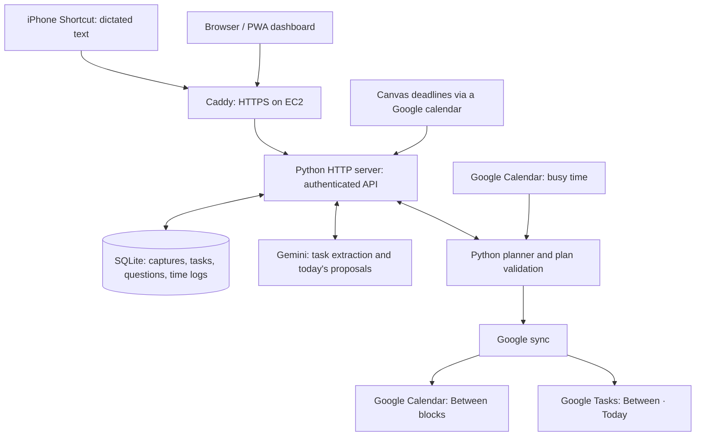

# Between

**Turn the gaps in your day into done things.**

You have 25 minutes before class. A reading due tonight. A quiz on Friday. And a reminder you told yourself you would remember.

The time is there, but figuring out what to do with it takes time too. A calendar shows where you need to be. A to-do list shows what you owe. You still have to connect the two, estimate the work, and decide where to start.

Between connects them.

Built as a solo project for **Sun Hacks 2026**, Between turns scattered thoughts, school deadlines, and the free spaces in a student's calendar into a plan they can act on. Tell it what's on your mind, tell it how much time you have, and take the next small step.

The motivation is simple: an organized list can still feel overwhelming. Between is designed for students who struggle with procrastination, executive function, and task initiation. Its goal is to reduce the decisions between remembering a task and beginning it, without guilt or a constant stream of notifications. This is a product design goal, not a claim of clinical effectiveness.

## From “I need to…” to “I did”

Imagine leaving class and remembering three things at once:

> “Read chapter four for 20 minutes, start my reflection paper before Friday, and email my professor.”

Type it into Between or dictate it through an iPhone Shortcut. Gemini separates the thought into tasks and asks for clarification when it needs more information. Google Calendar supplies the busy times, and a connected Canvas calendar brings in school deadlines.

Between then spreads the work across the next two weeks, fitting sessions into available time before each deadline. Gemini helps choose today's sessions and explains why they belong there. A rule-based planner checks those suggestions and provides a fallback when Gemini is unavailable.

The result shows up where you already look: **“Between:” blocks in Google Calendar**, a **“Between · Today” list in Google Tasks**, and a dashboard that answers a smaller, more useful question:

**What can I do with the time I have right now?**

## A little help from Pip

Pip is Between's original companion character: a small, cozy presence beside the plan. When a thought needs a little more detail, Pip has a question. When you have a gap, the dashboard helps you find something that fits.

Tasks appear in three groups: **Urgent & important**, **Urgent**, and **Important**. You can log time, mark work complete, or say **“Not today”** and let the planner adjust. The point is to make getting started feel manageable, even when the whole week doesn't.

## What works today

- **Capture by text or voice.** Brain-dump in the dashboard or send dictated thoughts through an iPhone Shortcut.
- **Turn thoughts into tasks.** Gemini separates captures into actionable items and follow-up questions.
- **Plan around real commitments.** Google Calendar busy times keep work sessions out of class and other events.
- **Bring in school deadlines.** Assignments arrive through a Google Calendar named `canvas`.
- **Spread work before it's due.** A two-week planner schedules sessions, with reasons for today's choices.
- **Find a task for your gap.** Choose how many minutes you have and see work that fits.
- **Keep the plan close.** Sync to Google Calendar and Google Tasks, and use the installable web app on your phone.

The owner has verified the AWS-hosted dashboard and remote iPhone voice capture. Automated tests exercise logic and mocked integrations; they do not establish live phone or cloud availability.

## Demo and screenshots

Follow the [two-minute student story](docs/DEMO.md) for the hackathon walkthrough and rehearsal checklist.

| Planned visual | Status |
| --- | --- |
| Dashboard: Pip, available minutes, and today's plan | Screenshot pending; use fictional tasks |
| Capture: a messy thought becomes tasks and a follow-up question | Screenshot pending |
| Calendar and Google Tasks: work placed around commitments | Screenshot pending; use a demo calendar |
| Two-minute recording | Recording link pending |

No screenshots or recordings are included yet. Add only captures reviewed for personal information, account details, and token-bearing URLs.

## Under the hood

The dashboard uses vanilla JavaScript, HTML, and CSS. A Python standard-library HTTP server handles capture, planning, and integrations, with SQLite storing tasks and captures. Gemini handles brain-dump interpretation and today's planning suggestions; Python rules validate the plan and keep scheduling available when the model cannot respond.

The hosted version runs on AWS EC2 with Docker and Caddy for HTTPS. Voice capture uses Apple's Shortcuts app to send dictated text to the same capture endpoint as the dashboard.



| Layer | Technology and responsibility |
| --- | --- |
| Interface | Vanilla JavaScript, HTML, CSS, web app manifest; original Pip SVG artwork |
| Backend | Python standard library HTTP server and SQLite |
| AI | Gemini API with JSON responses, application validation, and rule fallbacks |
| Planning | `task_rules.py` for scheduling and validation; `gap_engine.py` for the current free window |
| Integrations | Google Calendar and Google Tasks APIs; Apple Shortcuts; Canvas calendar feed |
| Hosting | AWS EC2, Docker Compose, Caddy HTTPS, persistent server-side data |

### Gemini's role and limits

Gemini interprets captures into task titles, estimates, categories, deadlines, and occasional clarification questions. It also currently proposes today's sessions and their reasons. Python validates task identities, free-time boundaries, session limits, and daily capacity before accepting a plan; rules schedule subsequent days and provide the fallback.

The roadmap will move Gemini to an explanation layer over deterministic scheduling. That change is **not implemented yet**. Neither are automatic task decomposition, semantic duplicate merging, Ask Pip, behavioral insights, or Gemini Live conversations. Current voice capture sends the Shortcut's dictated text; it is not a live voice conversation with Gemini.

## Run locally

The hosted server is the single source of truth. Do not start a second server with the production Google credentials.

For an isolated development copy on the Mac, with no production credentials or data:

```bash
cd ~/projects/between
test -e .env || cp .env.example .env
```

Keep all connector values empty for a rules-only preview. If this checkout already has a production `.env`, use a separate clean checkout instead of running it. The application itself requires Python 3.9+ with time-zone data and no third-party Python packages. On this Mac, use `/usr/bin/python3` because the other installed Python has Google TLS verification issues.

For integration development, use a separate test Google account and configure `.env` locally:

| Setting | Purpose |
| --- | --- |
| `GEMINI_API_KEY`, `GEMINI_MODEL` | Capture extraction and today's proposals; the project currently configures `gemini-flash-lite-latest` |
| `GOOGLE_CLIENT_ID`, `GOOGLE_CLIENT_SECRET`, `GOOGLE_REFRESH_TOKEN` | Google OAuth credentials; `scripts/google_auth.py` requests Calendar read, event write, and Tasks scopes |
| `TIMEZONE` | Planning time zone; defaults to `America/Phoenix` |
| `CANVAS_CALENDAR_NAME` | Calendar containing Canvas due dates; defaults to `canvas` |
| `APP_URL` | Hosted app base URL for task links |
| `BETWEEN_BEHIND_PROXY` | Set to `1` behind HTTPS hosting so loopback requests also require authentication |

The template predates Gemini support; add the Gemini settings yourself when using AI features. The active Canvas import reads the Google calendar feed, so the template's direct Canvas API settings are not required for that path. `.env` takes precedence over inherited shell settings.

Start the server with Apple Python:

```bash
/usr/bin/python3 server.py
```

Open **http://127.0.0.1:8765**.

Startup performs a Google sync, then repeats every 30 minutes during active hours. Never connect this preview to the production account while the hosted instance is running.

For phone setup on home Wi-Fi, see [Phone Setup](docs/PHONE_SETUP.md). For the hosted setup, HTTPS, and phone access away from home, see [Deployment](docs/DEPLOY.md).

## AWS deployment

The existing deployment uses one EC2 instance with Docker Compose. Caddy handles HTTPS; the app container has no public port. The server keeps its own `.env` and persistent `data/` directory outside the image.

The [deployment guide](docs/DEPLOY.md) covers prerequisites, existing-server updates, private link generation, and verification using placeholders. Creating resources or deploying requires the owner's approval. Normal updates use `deploy/deploy.sh` without data-copy flags; never use `--with-data` without explicit approval to replace hosted data.

Known deployment issue: the token was previously absent on the host and needed manual initialization. Startup and private-link generation safeguards still need work; [the reconciliation notes](docs/ROADMAP-STATUS.md) explain the current failure path. Do not treat a “copied” message as proof that a generated link is valid.

## Tests

```bash
/usr/bin/python3 -m unittest discover -s tests -p 'test_*.py'
```

Tests mock Gemini and Google integrations and disable automatic Google Tasks sync so they do not write test tasks to the real account.

Frontend contract checks verify that JavaScript's literal element references exist in the HTML, including Pip's question section, and that asset and cache versions agree. These checks do not replace a browser rehearsal. See [current implementation and verification notes](docs/ROADMAP-STATUS.md).

## Data and privacy

Captures and tasks live in SQLite on the machine running Between. Credentials stay in `.env`; the database and phone capture token stay in `data/`. These private files are excluded from Git.

Gemini receives capture text, relevant task information, and calendar time ranges for planning, **not busy-event titles**. Canvas assignment titles are task data and may therefore appear in planning context. Google receives the task list and calendar blocks created by sync. Apple Shortcuts handles dictation; Between's capture endpoint receives text, not raw audio.

Hosted API data requires a shared private token, including behind the reverse proxy. The dashboard stores it in browser local storage after the initial private link and removes it from the address bar. This is a single-user prototype, not a multi-user account system. Treat the link like a password, and use trusted devices. Caddy disables referrer sharing and does not enable access logging; the service worker excludes API requests and token-bearing URLs from its cache. Application request-log redaction still needs an audit; do not share raw server logs.

Do not commit credentials, data, private calendar links, SSH keys, or authenticated URLs. Review screenshots before sharing. Before making the repository public, perform a separate full-history secret review and check the hackathon's AI-tool disclosure requirements; no submission-compliance claim is made here.

## What's next

Work proceeds one approved phase at a time:

1. **Story and demo:** documentation, architecture, and a rehearsed student walkthrough.
2. **Smart Canvas tasks:** actionable titles, assignment types and estimates, original metadata, processing once, and protected user edits.
3. **Approachable steps:** ordered subtasks with dependencies, preserved deadlines, and no parent double-scheduling.
4. **Conservative duplicates and quiet filing:** high-confidence merges and low-interruption someday capture.
5. **Ask Pip:** concise answers grounded in tasks and available time, initially read-only.
6. **Scheduling explanations:** Gemini describes deterministic decisions, with cached rule-based fallbacks.
7. **Supported patterns:** transparent summaries only after at least 14 days and enough observations; suggestions require acceptance.
8. **Live voice:** explicit start/stop, transcription, secure sessions, and duplicate-safe capture after checking current API support.
9. **Cozy UI polish:** accessibility, mobile states, gentle motion, and clear error handling while preserving Pip.

See [roadmap reconciliation](docs/ROADMAP-STATUS.md) for what is implemented versus planned. Logging time currently records progress and supports estimate adjustments; it does not yet learn personal work patterns.

For now, it starts with the gap you already have.
