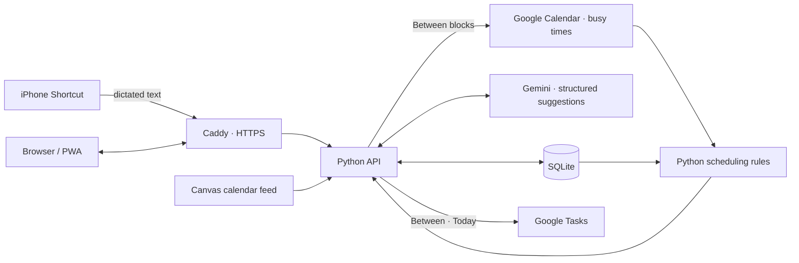

<p align="center">
  
</p>

# Between

**Between — Life happens between your plans.**<br>**SunHacks 2026 · Solo developer project**

Between turns student brain dumps, school deadlines, and calendar gaps into a practical next step.

[](#technology)
[](#how-it-works)
[](#technology)
[](#technology)

**[Watch the demo](https://www.youtube.com/watch?v=zYgGRX92xEA)** · **[Open Between](https://pipbetween.duckdns.org)**

[](https://www.youtube.com/watch?v=zYgGRX92xEA)

Pip's narration in the demo was created with **ElevenLabs**. It is not part of the application.

## The idea

A student may have 20 minutes before class, a reading due tonight, and several tasks competing for attention. Between connects the task list to the calendar, then helps the student choose where to start. Pip is the original companion in the interface: gentle, practical, and focused on the next action.

## What it does

- Capture thoughts by typing or iPhone Shortcut dictation.
- Use Gemini to extract tasks, estimates, due dates, and clarification questions.
- Turn larger tasks into ordered steps and show the next one.
- Import Canvas assignments with actionable titles and bounded, type-based estimates.
- Match likely duplicates conservatively and save low-urgency tasks to Someday.
- Ask Pip read-only questions grounded in current tasks and calendar availability.
- Schedule work around Google Calendar commitments; sync blocks to Calendar and a daily list to Google Tasks.
- Record time and skips. Show behavioral observations only when enough history supports them.

The project aims to make task initiation less overwhelming; it does not claim clinical effectiveness.

## How it works



Gemini interprets language and chooses among supported explanations. Python validates the output and controls task identity, persistence, dependencies, deadlines, and schedule capacity. If a model call fails or returns invalid data, deterministic rules provide a fallback. That division makes Between more than an LLM API wrapper.

The two-week planner uses deadlines, priority, skips, remaining estimates, free-time windows, ordered steps, daily limits, and transition buffers. It is a greedy scheduler; it cannot guarantee every deadline will fit. Busy-event titles are not sent to Gemini.

## Technology

- **Application:** Python standard library, JavaScript, HTML5, CSS3, SVG, SQLite, JSON APIs.
- **AI and integrations:** Google Gemini, Google Calendar, Google Tasks, Google OAuth, Canvas calendar feed, iOS Shortcuts.
- **Hosting:** AWS EC2, Docker Compose, Caddy, HTTPS/TLS, DuckDNS.
- **Engineering:** relational schema design and migrations, structured-output validation, prompt design, heuristics, shell deployment scripts, Git/GitHub, unit and regression testing.

SQLite persists captures, tasks, steps, logs, imports, and activity. Migrations add schema elements while preserving existing task records. The single-user hosted application authenticates devices with a shared private token.

## Engineering notes

- Model output is treated as untrusted input and checked against application rules.
- Conservative duplicate matching favors avoiding incorrect merges over catching every paraphrase.
- Canvas estimates use assignment titles, not unseen assignment instructions.
- Calendar and Tasks synchronization is asynchronous and cannot update both services atomically.
- The project uses a small stack suitable for a solo hackathon build; it is not a multi-user service.

The main challenges were keeping Between's own calendar blocks from appearing as new conflicts, making repeated captures and Canvas imports safe, and ensuring steps do not double-count parent tasks. These required state and validation rules alongside the AI prompts.

## Validation

| Check | Result |
| --- | --- |
| Backend tests | 261 passed; zero failures |
| Frontend runtime checks | 8 passed in a synthetic DOM |
| Python and JavaScript syntax | Passed |
| Migration and persistence checks | Passed |

Tests use temporary databases and mocked external services. They do not establish comprehensive browser coverage, offline support, performance benchmarks, or model quality.

## Run locally

Use a clean checkout and a separate test account. Do not connect a local instance to production credentials or data.

```bash
git clone https://github.com/rebelrocket0/between.git
cd between
cp .env.example .env
/usr/bin/python3 -m unittest discover -s tests -p 'test_*.py'
node tests/frontend_runtime.cjs
/usr/bin/python3 server.py
```

Open `http://127.0.0.1:8765`. Leave connector credentials blank for a rules-only preview. Add Gemini and Google credentials to the private `.env` to enable those integrations. Keep `.env`, `data/`, OAuth files, keys, and authenticated links out of Git.

The hosted application runs on EC2 in Docker Compose. Caddy terminates HTTPS and proxies to the app privately. SQLite and runtime credentials stay in persistent server-side mounts, outside the image. Deployment instructions are in [docs/DEPLOY.md](docs/DEPLOY.md).

## Limitations and next steps

Between is a single-user prototype with greedy scheduling, estimated task durations, conservative text matching, polling-based updates, and asynchronous third-party sync. The web app has a manifest and service-worker source, but offline behavior is unverified. Voice capture uses iPhone dictation; Gemini Live is not implemented. Behavioral observations require sufficient recorded history and do not automatically change the plan.

Possible next steps include stronger multi-user authentication, improved recovery from partial sync failures, accessibility and real-device testing, verified offline behavior, and interactive voice. These are future opportunities, not features of the submitted build.

## Project notes

Between was submitted to SunHacks 2026. This README and repository presentation were updated after submission. The demo script is a rehearsal aid, not a transcript: [docs/DEMO.md](docs/DEMO.md). See [release notes](docs/RELEASE-REVIEW.md) and [feature status](docs/ROADMAP-STATUS.md) for more detail.
